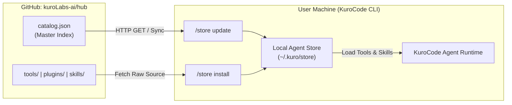

# 🧩 KuroLabs Capability Hub (`kuroLabs-ai/hub`)

[](catalog.json)
[](https://github.com/kuroLabs-ai)
[](LICENSE)

Welcome to the official **KuroLabs Capability Hub** repository hosted at [`kuroLabs-ai/hub`](https://github.com/kuroLabs-ai/hub).

This repository serves as the **Central Online Catalog & Registry** for the **KuroCode** AI Agent ecosystem. It provides a modular, plug-and-play directory of capabilities—often referred to as **"puzzle pieces"**—including standalone **Tools**, modular **Plugins**, procedural **Skills**, and external **Integrations**.

---

## 📖 Table of Contents

- [What is `kuroLabs-ai/hub`?](#-what-is-kurolabs-aihub)
- [What Does It Do?](#-what-does-it-do)
- [How Does It Work?](#-how-does-it-work)
- [Repository Structure](#-repository-structure)
- [How to Get From It (Download & Consume)](#-how-to-get-from-it-download--consume)
  - [1. Using KuroCode In-Terminal Store (Recommended)](#1-using-kurocode-in-terminal-store-recommended)
  - [2. Using Git Directly](#2-using-git-directly)
- [How to Add To It (Contribute & Publish)](#-how-to-add-to-it-contribute--publish)
  - [Step 1: Fork and Clone](#step-1-fork-and-clone)
  - [Step 2: Create a Feature Branch](#step-2-create-a-feature-branch)
  - [Step 3: Author Your Capability](#step-3-author-your-capability)
  - [Step 4: Register in `catalog.json`](#step-4-register-in-catalogjson)
  - [Step 5: Commit, Push, and Open a Pull Request](#step-5-commit-push-and-open-a-pull-request)
- [Catalog Schema Reference](#-catalog-schema-reference)
- [Quality & Security Standards](#-quality--security-standards)
- [License & Community](#-license--community)

---

## 🔍 What is `kuroLabs-ai/hub`?

`kuroLabs-ai/hub` is the open community registry for extending the autonomous capabilities of KuroCode AI agents.

Rather than bundling every possible tool, utility, and workflow into the core KuroCode runtime, the ecosystem relies on a decentralized, catalog-driven architecture:
- Core KuroCode stays lightweight, secure, and fast.
- Domain-specific tools (finance, cryptography, AST inspection, code quality) are fetched on-demand.
- Community developers can share their specialized workflows and tools with all KuroCode agents worldwide.

---

## ⚙️ What Does It Do?

The Hub organizes and distributes four distinct types of agent capabilities:

| Type | Directory | Description | Examples in Hub |
| :--- | :--- | :--- | :--- |
| **Tools** | `tools/` | Single-file, deterministic Python functions callable directly by the agent during tasks. | `json_inspector.py`, `hash_calculator.py`, `regex_tester.py`, `currency_converter.py` |
| **Plugins** | `plugins/` | Multi-file or package-based extensions with a `plugin.json` manifest and an entrypoint script. | `code_metrics/`, `dependency_guard/` |
| **Skills** | `skills/` | Structured, step-by-step procedural workflows defined in `SKILL.md` (YAML frontmatter + markdown execution guidelines). | `tdd_refactoring/`, `security_audit/` |
| **Integrations** | N/A | Declarative connectors for external webhooks, APIs, and devops platforms. | `gitlab`, `slack` |

---

## 🔄 How Does It Work?

The Hub operates as a centralized registry connected to KuroCode's store management engine:



1. **Indexing (`catalog.json`)**: All approved capabilities are registered in `catalog.json` with metadata: unique ID, version, description, tags, entrypoints, and file locations.
2. **Syncing (`/store update`)**: KuroCode clients fetch the latest `catalog.json` from the `main` branch to refresh their local index.
3. **Discovery (`/store search`, `/store list`)**: Users or autonomous agents search through cached capabilities by tag, keyword, or category.
4. **On-Demand Installation (`/store install`)**: KuroCode downloads the associated script or directory and integrates it into the agent's active execution environment.

---

## 📂 Repository Structure

```text
hub/
├── catalog.json                       # Central registry of all approved capabilities
├── README.md                          # Documentation and contribution guide
├── tools/                             # Standalone single-file Python tools
│   ├── currency_converter.py          # Currency exchange calculation utility
│   ├── hash_calculator.py             # MD5, SHA1, SHA256, SHA512 hashing utility
│   ├── json_inspector.py              # JSON validator, formatter, schema inspector
│   └── regex_tester.py                # Regex validator and pattern matching
├── plugins/                           # Multi-file modular plugins
│   ├── code_metrics/                  # Lines of code and function metrics analyzer
│   │   ├── plugin.json                # Plugin manifest
│   │   └── main.py                    # Implementation entrypoint
│   └── dependency_guard/              # Scans requirements.txt for unpinned deps
│       ├── plugin.json                # Plugin manifest
│       └── main.py                    # Implementation entrypoint
└── skills/                            # Procedural routines and agent workflows
    ├── security_audit/                # AST and secret scanning workflow
    │   └── SKILL.md                   # Step-by-step routine definition
    └── tdd_refactoring/               # Test-driven development refactoring routine
        └── SKILL.md                   # Step-by-step routine definition
```

---

## 📥 How to Get From It (Download & Consume)

### 1. Using KuroCode In-Terminal Store (Recommended)

When working inside KuroCode, you can interact with `kuroLabs-ai/hub` directly via slash commands:

#### Update & Refresh the Catalog
Fetch the latest puzzle pieces published to the Hub:
```bash
/store update
```

#### Search and Browse
Find capabilities matching your task:
```bash
/store list
/store search crypto
/store search security
/store search metrics
```

#### Install a Capability by Name
Install any tool, plugin, skill, or integration listed in the catalog:
```bash
/store install regex_tester
/store install dependency_guard
/store install security_audit
/store install gitlab
```

#### Install Directly from a URL
Install cutting-edge or experimental tools directly from raw GitHub links:
```bash
/store install https://raw.githubusercontent.com/kuroLabs-ai/hub/main/tools/regex_tester.py
```

---

### 2. Using Git Directly

If you want to inspect, test, or manually borrow tools and skills for local development:

#### Clone the Entire Hub Repository
```bash
git clone https://github.com/kuroLabs-ai/hub.git
cd hub
```

#### Pull Latest Catalog Updates
```bash
git pull origin main
```

#### Copying Capabilities Locally
You can copy standalone tools or skills directly into your local agent workspace or personal library:
```bash
# Example: Copy regex tester to your custom project tools
cp tools/regex_tester.py path/to/your/project/tools/
```

---

## 📤 How to Add To It (Contribute & Publish)

Publishing your own capability makes it immediately available to the entire KuroCode community. Follow the Git workflow below:

### Step 1: Fork and Clone

1. Fork `https://github.com/kuroLabs-ai/hub` to your personal GitHub account.
2. Clone your fork locally:
   ```bash
   git clone https://github.com/<your-username>/hub.git
   cd hub
   ```
3. Set upstream remote to keep your fork updated:
   ```bash
   git remote add upstream https://github.com/kuroLabs-ai/hub.git
   ```

### Step 2: Create a Feature Branch

Create a dedicated branch for your capability:
```bash
git checkout -b feat/add-<capability-name>
```

---

### Step 3: Author Your Capability

Choose the appropriate type for your contribution:

#### Option A: Adding a Standalone Tool (`tools/`)
Create `tools/<tool_name>.py`. Tools must be self-contained and return a JSON-serializable dictionary:
```python
"""
community_hub/tools/<tool_name>.py
Description of what the tool does.
"""

def my_tool(param1: str, param2: int = 10) -> dict:
    """Clear docstring explaining behavior and parameters."""
    try:
        # Implementation using Python standard library where possible
        result = ...
        return {"success": True, "data": result}
    except Exception as e:
        return {"success": False, "error": str(e)}
```

#### Option B: Adding a Modular Plugin (`plugins/`)
Create a new directory `plugins/<plugin_name>/` containing:
1. `plugin.json`:
   ```json
   {
     "name": "<plugin_name>",
     "version": "1.0.0",
     "description": "Clear explanation of plugin function.",
     "entrypoint": "main.py"
   }
   ```
2. `main.py` (and any supporting modules).

#### Option C: Adding a Procedural Skill (`skills/`)
Create `skills/<skill_name>/SKILL.md` with YAML frontmatter:
```markdown
---
name: <skill_name>
version: 1.0.0
description: Clear summary of the procedural routine.
author: <YourGitHubUsername>
tags: [tag1, tag2]
---

# <Skill Title>

Context and purpose of this procedure.

## Steps:
1. **Phase 1**: Initial inspection.
2. **Phase 2**: Action step.
3. **Phase 3**: Verification and checkpointing.
```

---

### Step 4: Register in `catalog.json`

Append your capability entry to [`catalog.json`](catalog.json).

#### Example: Tool Entry
```json
{
  "id": "tool_my_tool",
  "name": "my_tool",
  "item_type": "tool",
  "description": "Calculates custom data transformations.",
  "version": "1.0.0",
  "author": "YourGitHubUsername",
  "tags": ["utility", "transformation"],
  "file_path": "tools/my_tool.py",
  "payload": {
    "entrypoint": "my_tool"
  }
}
```

#### Example: Plugin Entry
```json
{
  "id": "plugin_my_plugin",
  "name": "my_plugin",
  "item_type": "plugin",
  "description": "Provides comprehensive codebase linting and checks.",
  "version": "1.0.0",
  "author": "YourGitHubUsername",
  "tags": ["lint", "analysis"],
  "file_path": "plugins/my_plugin/main.py",
  "payload": {
    "manifest_path": "plugins/my_plugin/plugin.json"
  }
}
```

#### Example: Skill Entry
```json
{
  "id": "skill_my_routine",
  "name": "my_routine",
  "item_type": "skill",
  "description": "Systematic routine for architectural refactoring.",
  "version": "1.0.0",
  "author": "YourGitHubUsername",
  "tags": ["workflow", "architecture"],
  "file_path": "skills/my_routine/SKILL.md",
  "payload": {
    "steps": [
      "Analyze current structure.",
      "Execute safe transformations.",
      "Run tests and verify."
    ]
  }
}
```

---

### Step 5: Commit, Push, and Open a Pull Request

1. Stage and commit your changes:
   ```bash
   git add .
   git commit -m "feat: add <capability-name> to catalog"
   ```
2. Push your feature branch to your fork:
   ```bash
   git push origin feat/add-<capability-name>
   ```
3. Open a **Pull Request (PR)** against the `main` branch of `kuroLabs-ai/hub`.
4. Once reviewed and merged by the KuroLabs team, your piece will immediately be live to every KuroCode agent running `/store update`!

---

## 📋 Catalog Schema Reference

Every record in [`catalog.json`](catalog.json) supports the following keys:

| Field | Type | Required | Description |
| :--- | :--- | :--- | :--- |
| `id` | `string` | Yes | Unique ID prefixed by type (e.g. `tool_hash_calculator`, `skill_tdd_refactoring`). |
| `name` | `string` | Yes | Human-readable identifier used for `/store install <name>`. |
| `item_type` | `string` | Yes | One of: `"tool"`, `"plugin"`, `"skill"`, `"integration"`. |
| `description` | `string` | Yes | Brief description of capabilities and behavior. |
| `version` | `string` | Yes | Semantic version string (e.g. `"1.0.0"`). |
| `author` | `string` | Yes | GitHub username or team organization. |
| `tags` | `string[]`| Yes | Search keywords for `/store search <query>`. |
| `file_path` | `string` | Optional | Relative path from repo root (e.g. `tools/my_tool.py`). |
| `payload` | `object` | Yes | Type-specific configuration (e.g. `entrypoint`, `manifest_path`, `steps`, or `required_env`). |

---

## 🛡️ Quality & Security Standards

To keep the ecosystem reliable and safe for all users, all submissions must comply with:
- **Standard Library First**: Tools and plugins should minimize external PyPI dependencies. If required, state them explicitly in `plugin.json` or docstrings.
- **Graceful Error Handling**: Return `{"success": False, "error": str(e)}` instead of crashing the agent's process.
- **Deterministic and Safe**: Tools should never execute arbitrary unescaped shell strings or mutate system environments without user confirmation.
- **Documentation**: All tools require clear docstrings detailing arguments and return schemas; skills require clear Markdown step definitions.

---

## 🤝 Community & Support

- **Repository**: [github.com/kuroLabs-ai/hub](https://github.com/kuroLabs-ai/hub)
- **Organization**: [github.com/kuroLabs-ai](https://github.com/kuroLabs-ai)
- **Issues & Suggestions**: Open an issue on GitHub for new capability ideas or bug reports.

*Maintained with ❤️ by [KuroLabs](https://github.com/kuroLabs-ai).*
